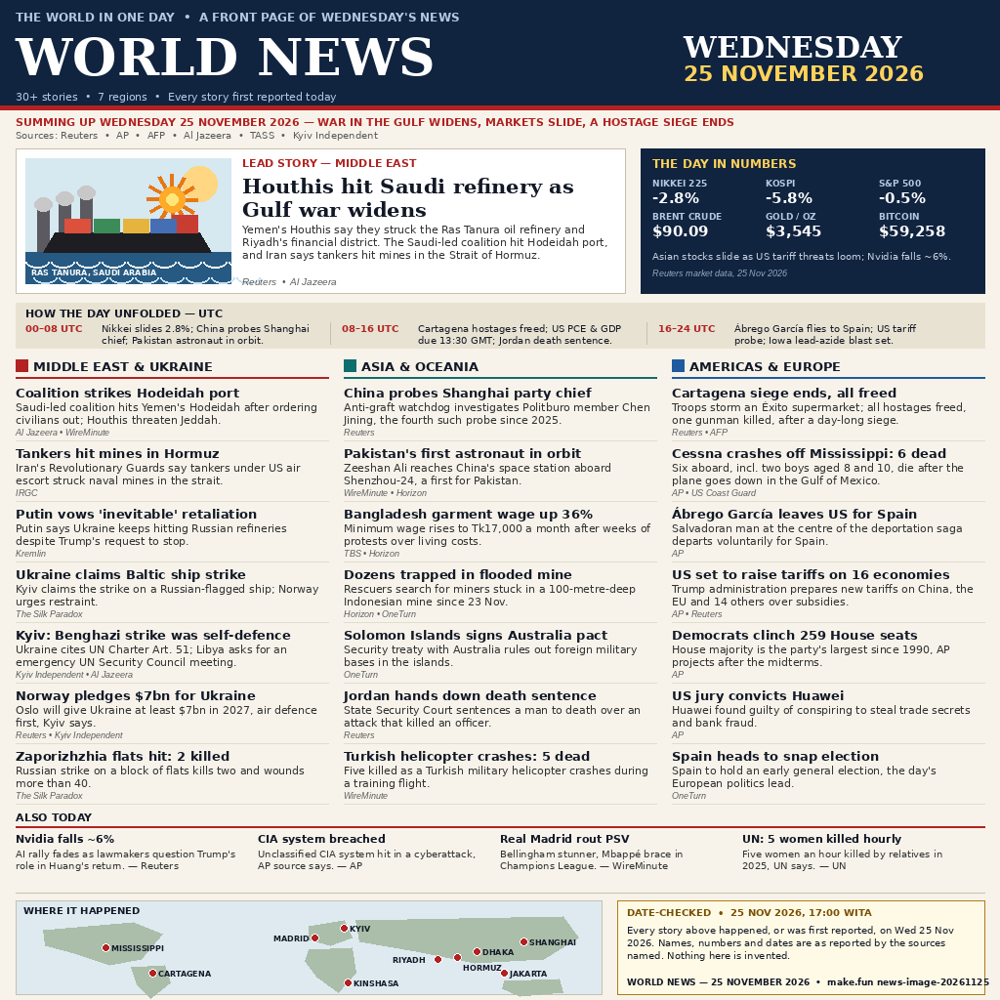

# World News — 25 November 2026

[](https://make.fun/c/news-image-20261125)
[](https://make.fun/c/news-image-20261125)
[](https://make.fun/c/news-image-20261125)

Entry for the make.fun competition
[`news-image-20261125`](https://make.fun/c/news-image-20261125) — "Sum up 25
November's world news in one image".



## What it is

A dense one-day front page summing up the world's news of **Wednesday,
25 November 2026**: a lead story with a drawn illustration, a UTC timeline
strip, the day in numbers, 21 short dated stories across seven regions, four
"also today" briefs, a pin map of where it happened, and a date-check line.
Drawn with Python (PIL) in [`draw.py`](draw.py); `main.py` copies the bundled
`entry.png` to the output directory, so both grader runs write identical
bytes with no network.

## Stories in the image (all first reported on 25 Nov 2026)

### Lead story

- **Houthis hit Saudi refinery as Gulf war widens** — Yemen's Houthis say
  they struck the Ras Tanura oil refinery and Riyadh's financial district;
  the Saudi-led coalition hit Hodeidah port; Iran says tankers hit mines in
  the Strait of Hormuz. *Reuters; Al Jazeera*

### Middle East & Ukraine

- Saudi-led coalition strikes Hodeidah port after ordering civilians out;
  Houthis threaten Jeddah. *Al Jazeera; WireMinute*
- Iran's Revolutionary Guards say tankers under US air escort struck naval
  mines in the Strait of Hormuz. *IRGC; The Silk Paradox*
- Putin vows "inevitable" retaliation as Ukraine keeps hitting Russian
  refineries. *Kremlin; The Silk Paradox*
- Ukraine claims the Baltic ship strike; Norway urges restraint.
  *The Silk Paradox*
- Kyiv calls the Benghazi strike self-defence under UN Charter Art. 51;
  Libya asks for an emergency UN Security Council meeting.
  *Kyiv Independent; Al Jazeera; TASS*
- Norway pledges at least $7bn for Ukraine in 2027, air defence first.
  *Reuters; Kyiv Independent*
- Russian strike on a block of flats in Zaporizhzhia kills two, wounds 40+.
  *The Silk Paradox*

### Asia & Oceania

- China investigates Shanghai party chief Chen Jining — the fourth Politburo
  graft probe since 2025. *Reuters*
- Pakistan's first astronaut, Zeeshan Ali, reaches China's space station
  aboard Shenzhou-24. *WireMinute; Horizon*
- Bangladesh garment minimum wage rises 36% to Tk17,000 a month after weeks
  of protests. *The Business Standard; Horizon*
- Dozens trapped in a flooded 100-metre-deep mine in Indonesia; rescue under
  way. *Horizon; OneTurn*
- Solomon Islands signs a security treaty with Australia ruling out foreign
  military bases. *OneTurn*
- Jordan's State Security Court sentences a man to death over an attack that
  killed an officer. *Reuters*
- Five killed as a Turkish military helicopter crashes during a training
  flight. *WireMinute*

### Americas & Europe

- Cartagena supermarket siege ends: all hostages freed, one gunman killed.
  *Reuters; AFP; AP; Al Jazeera*
- Cessna 210 crashes into the Gulf of Mexico off Mississippi; six aboard
  dead, including two boys aged 8 and 10. *AP; US Coast Guard*
- Kilmar Ábrego García leaves the US voluntarily for Spain, ending the
  deportation saga. *AP*
- Trump administration prepares new tariffs on China, the EU and 14 other
  economies. *AP; Reuters*
- Democrats clinch a House majority of at least 259 seats, their largest
  since 1990. *AP*
- US jury convicts Huawei of conspiracy to steal trade secrets and bank
  fraud. *AP*
- Spain heads to a snap election. *OneTurn*

### Also today

- Nvidia shares fall ~6% as lawmakers question Trump's role in Jensen
  Huang's return as CEO. *Reuters; AP*
- An unclassified CIA system was breached in a cyberattack, AP source says.
  *AP*
- Real Madrid rout PSV in the Champions League; Bellingham stunner, Mbappé
  brace. *WireMinute*
- Five women an hour were killed by relatives in 2025, the UN says. *UN
  via WireMinute*

### The day in numbers (Reuters market data, 25 Nov 2026)

Nikkei 225 −2.8% · KOSPI −5.8% · S&P 500 −0.5% · Brent crude $90.09 ·
Gold $3,545/oz · Bitcoin $59,258.

## Stories verified during research but not drawn (space)

- Russia's Duma passes the 2027–29 budget. *The Silk Paradox*
- No date set for the next round of peace talks, the Kremlin says. *TASS*
- Hungary's PM Péter Magyar meets President Zelensky in Uzhhorod.
  *The Silk Paradox*
- Moscow summons Latvia's diplomat as Riga weighs closing its border.
  *The Silk Paradox*
- Hong Kong marks one year since the deadly Tai Po fire. *OneTurn*
- China's Qianfan satellite network is its answer to Starlink.
  *The Diplomat*
- Zambia indicts an opposition leader on treason charges. *OneTurn*
- DR Congo says a military aircraft is missing as rebels claim they shot it
  down. *OneTurn*
- DR Congo rebels call off their advance on Bunia. *WireMinute*
- WHO chief urges an end to the US fuel blockade on Cuba. *WireMinute*
- Landmine toll reaches a five-year high, Myanmar and Syria bearing the
  brunt. *WireMinute*
- Trump awards the Medal of Freedom to Rudy Giuliani. *AP*
- Trump pardons Thanksgiving turkeys Freedom and Feathers. *AP*
- US Army to detonate 5 tons of unstable lead azide in Iowa. *AP*
- Microsoft declares "Code Red" after a historic outage. *Reuters*
- US inflation (PCE) and Q3 GDP data due 13:30 GMT. *Reuters*
- Senegal regains the Africa Cup title as CAS overturns the CAN-2025 result.
  *Horizon; CAS*
- Macy's Thanksgiving Day Parade turns 100 (26 Nov). *AP*

## Verification

Every story above happened, or was first reported, on Wednesday
25 November 2026, and is stated as the named sources reported it. No story,
quote, number or date was invented. Research was done on 25 Nov 2026
(17:00 WITA) from Reuters, AP, AFP, Al Jazeera, TASS, Kyiv Independent,
The Business Standard, The Diplomat, and the day's news digests (OneTurn,
Horizon, WireMinute, The Silk Paradox).

## Run it

```sh
mkdir -p out && MAKEFUN_OUTPUT_DIR=out python3 main.py
# writes out/entry.png — byte-identical on every run
```

## License

MIT — see [LICENSE](LICENSE).
